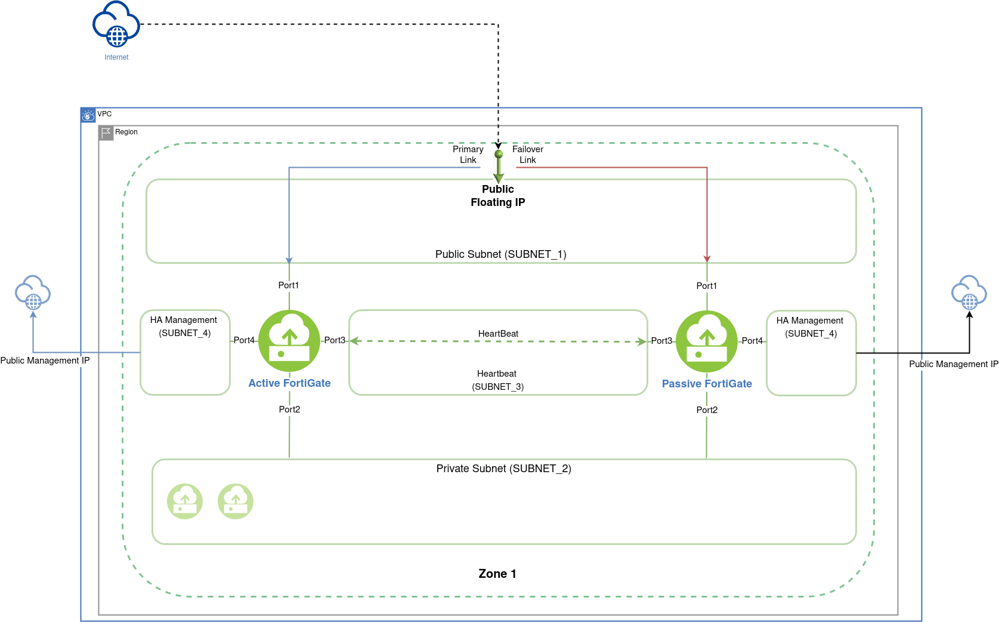

# FortiGate Active-Passive HA Deployment on IBM Cloud (Single Zone)

## Description

A Terraform based script that deploys an Active-Passive (A-P) HA cluster in a single zone. This script is used by the IBM Cloud Catalog offering `Fortinet FortiGate VM NGFW - A/P HA`. This template makes use of the FortiGate IBM SDN connector to failover in the event of a VM shutdown. After the active VM is back up, it will take over as active once again.

- This terraform will deploy a FortiGate license for the selected pricing plan.
- Users may submit support tickets to IBM Cloud for issues relating to this offering.
- The Virtual FortiGate is customer managed. Details on roles and responsibilities can be found [here](https://cloud.ibm.com/docs/licensed-firewall?topic=licensed-firewall-fortinet-racii-v3)

## Post-Deployment Considerations

### Firmware and Vulnerability Patching

For complete information about security maintenance and vulnerability management, see [Security maintenance and vulnerability management](https://cloud.ibm.com/docs/licensed-firewall?topic=licensed-firewall-security-maintenance-vulnerability-management).

Fortinet is responsible for identifying, investigating, and publishing security vulnerabilities that affect FortiGate products. Fortinet also provides security advisories, remediation guidance, firmware updates, and software fixes for affected products.

Your responsibilities for maintaining and operating your FortiGate deployment are defined in your service agreement and other applicable service documentation. Review your service agreement to understand your obligations regarding software maintenance, security updates, and vulnerability management.

**Monitoring security advisories**

Fortinet publishes security advisories through its Product Security Incident Response Team (PSIRT). Advisories include information about affected product versions, vulnerability severity, available mitigations, and recommended software updates.

IBM recommends that you regularly review Fortinet security advisories and evaluate whether remediation actions are required for your environment.

For more information, see the [Fortinet PSIRT portal](https://www.fortiguard.com/psirt).

**Subscribe to Fortinet notifications**

To receive notifications about security advisories, firmware releases, and other product updates, subscribe to Fortinet notification services.

Fortinet provides RSS feeds for security advisories, firmware releases, threat intelligence updates, and other product announcements. For more information, see [Manage Your Subscriptions to Fortinet](https://support.fortinet.com/).

**Accessing the FortiGate web management console**

Firmware upgrades require access to the FortiGate web management console on port 443. By default, this deployment attaches a Floating IP (FIP) to the FortiGate with deny-all inbound access for security. You can access the console using one of the following methods:

- **Floating IP with Allowlist**: Modify the security group rules to allowlist your source IP address for HTTPS (port 443) access to the attached FIP. This enables direct access to the FortiGate web console from the internet.
- **VPN Access (No FIP Required)**: Configure a VPN connection into your VPC to access the FortiGate management interface using its private IP address on port 443. This method does not require a Floating IP and provides secure private network access.

**Network requirements**

For firmware upgrades and license validation to function properly:

- **Egress Internet Access**: An egress route to the internet must be configured to allow the FortiGate to download firmware updates and validate the installed license.
- **Security Group Rules**: Ensure appropriate security group rules are in place to allow HTTPS (port 443) access from your management source IP addresses (when using FIP) or from your VPN subnet (when using VPN access).

**Best practices**

IBM recommends that you:

- Subscribe to Fortinet security notifications.
- Review Fortinet PSIRT advisories regularly.
- Maintain supported FortiOS versions.
- Apply security updates and remediation actions according to your organization's operational and security requirements.
- Include Fortinet security advisories in your vulnerability management processes.
- Ensure secure access to the FortiGate web management console before attempting firmware upgrades.
- Verify egress internet connectivity is available for firmware downloads and license validation.


## Requirements

-   [Terraform](https://learn.hashicorp.com/terraform/getting-started/install.html) 1.6+
-   IBM Cloud Terraform Provider version 2.1.0+
-   IBM Cloud Catalog offering CRNs (Version CRN and Plan CRN) for FortiGate
-   [A VPC with four subnets in a single zone](https://cloud.ibm.com/docs/vpc/vpc-getting-started-with-ibm-cloud-virtual-private-cloud-infrastructure)
-   [A configured IBM SSH key](https://cloud.ibm.com/docs/vpc?topic=vpc-ssh-keys)
-   IBM Cloud API key with appropriate permissions

## Key Features

- **Automatic Profile Selection**: VSI profile is automatically selected based on the catalog offering plan CRN
- **Region-Specific Support**: Handles region-specific profile availability (e.g., Chennai region where cx2 profiles are unavailable)
- **Dual Security Groups**: Two distinct security groups are automatically created — `sg-public` (port1 + port4) and `sg-private` (port2 + port3) — each with highly restrictive rules:
  - Inbound: self-referencing rule (inter-FGT traffic only)
  - Public SG outbound: restricted to FortiGuard services (UDP 53, TCP 853, TCP 443, TCP 8890)
  - Private SG outbound: self-referencing only (no internet access on internal/HA ports)
- **Public Gateway on Port1 Subnet**: Provides internet egress for the external subnet without requiring a floating IP on every instance
- **Metadata Service Enabled**: Required for VNF licensing
- **Catalog Offering Support**: Uses IBM Cloud Catalog offerings instead of custom images

## Deployment overview

Terraform deploys the following components:

-   Two FortiGate licensed instances (via IBM Cloud Catalog) with four NICs each, one in each subnet
-   Three floating Public IP addresses: one attached to the Primary FortiGate on Port1 (which will failover), and the other two attached to the HA management port (Port4) of each FortiGate
-   One log disk per FortiGate
-   A security group with appropriate inbound and outbound rules
-   A public gateway attached to the Port1 (external) subnet for shared internet egress — no floating IP needed per instance
-   A basic bootstrap configuration with HA support

## Deployment Diagram



## Configuration

### IBM Cloud Authentication
```hcl
IBMCLOUD_API_KEY = "your-ibm-cloud-api-key"
SSH_PUBLIC_KEY   = "your-ssh-key-name"
```

### Region and Zone
```hcl
REGION = "us-south"  # IBM Cloud region
ZONE   = "us-south-1"  # Availability zone
```

### VPC and Network Configuration
```hcl
VPC      = "your-vpc-name"
SUBNET_1 = "subnet-uuid-for-port1"  # Primary/Public subnet
SUBNET_2 = "subnet-uuid-for-port2"  # Secondary/Private subnet
SUBNET_3 = "subnet-uuid-for-port3"  # HA Heartbeat subnet
SUBNET_4 = "subnet-uuid-for-port4"  # HA Management subnet
```

> **Note:** For Subnets, the UUID is required, not the name.

### Static IP Configuration
```hcl
# FortiGate 1 (Primary/Active)
FGT1_STATIC_IP_PORT1 = "10.240.0.10"
FGT1_STATIC_IP_PORT2 = "10.240.1.10"
FGT1_STATIC_IP_PORT3 = "10.240.2.10"
FGT1_STATIC_IP_PORT4 = "10.240.3.10"
FGT1_PORT4_MGMT_GATEWAY = "10.240.3.1"

# FortiGate 2 (Secondary/Passive)
FGT2_STATIC_IP_PORT1 = "10.240.0.11"
FGT2_STATIC_IP_PORT2 = "10.240.1.11"
FGT2_STATIC_IP_PORT3 = "10.240.2.11"
FGT2_STATIC_IP_PORT4 = "10.240.3.11"
FGT2_PORT4_MGMT_GATEWAY = "10.240.3.1"
```

### Resource Configuration
```hcl
CLUSTER_NAME = "fortigate-ha"  # Must be lowercase
RESOURCE_GRP = "Default"
```

### Public Gateway

A pre-existing public gateway must be attached to the Port1 (external) subnet before deployment. This provides outbound internet access for FortiGuard license validation and firmware updates.

```hcl
PUBLIC_GATEWAY_ID = "r006-xxxxxxxx-xxxx-xxxx-xxxx-xxxxxxxxxxxx"  # ID of the pre-created public gateway
```

> **Note:** This is a required field. Create a public gateway in the same zone as your deployment and attach it to `SUBNET_1` before running `terraform apply`.

### Automatic Profile Selection

The VSI profile is automatically selected based on the `CATALOG_OFFERING_PLAN_CRN`. The mapping includes:

**Enterprise Plans:**
- 8vCPU Medium → cx3d-8x20
- 16vCPU Large → cx3d-16x40
- 32vCPU X-large → cx3d-32x80

**UTP Plans:**
- 2vCPU Small → cx3d-2x5
- 8vCPU Medium → cx3d-8x20
- 16vCPU Large → cx3d-16x40

**ATP Plans:**
- 2vCPU Small → cx2-2x4
- 8vCPU Medium → cx2-8x16

Region-specific overrides are automatically applied where certain profiles are unavailable (e.g., Chennai region).

## Outputs

The deployment provides the following outputs:

- `FortiGate_Public_IP`: Public IP address for the FortiGate cluster (attached to active instance)
- `FGT1_Public_HA_Management_IP`: Public IP for FortiGate 1 management
- `FGT2_Public_HA_Management_IP`: Public IP for FortiGate 2 management
- `Security_Group_ID`: ID of the automatically created security group
- `Security_Group_Name`: Name of the security group
- `Selected_VSI_Profile`: The VSI profile automatically selected based on the plan CRN
- `Catalog_Offering_Version_CRN`: The catalog offering version CRN used
- `Catalog_Offering_Plan_CRN`: The catalog offering plan CRN used
- `Username`: Default admin username (admin)
- `FGT1_Default_Admin_Password`: Instance ID (password may be empty on first boot)
- `FGT2_Default_Admin_Password`: Instance ID (password may be empty on first boot)

## Security Group Configuration

Two distinct security groups are automatically created, separating public-facing and private interfaces:

### `sg-public` — port1 (external) + port4 (HA management)

| Rule | Direction | Remote | Protocol | Port | Purpose |
|------|-----------|--------|----------|------|---------|
| `allow-inbound-from-same-sg` | Inbound | This SG | All | All | Inter-FGT traffic only |
| `allow-outbound-fortiguard-dns-udp-53` | Outbound | 0.0.0.0/0 | UDP | 53 | FortiGuard DNS & SDNS |
| `allow-outbound-dns-over-tls-tcp-853` | Outbound | 0.0.0.0/0 | TCP | 853 | DNS over TLS (DoT) |
| `allow-outbound-fortiguard-licensing-tcp-443` | Outbound | 0.0.0.0/0 | TCP | 443 | Licensing, FortiCare & Entitlements |
| `allow-outbound-fortiguard-updates-tcp-8890` | Outbound | 0.0.0.0/0 | TCP | 8890 | FortiGuard Distribution Updates |
| `allow-outbound-ntp-udp-123` | Outbound | 0.0.0.0/0 | UDP | 123 | NTP Time Synchronization |

### `sg-private` — port2 (internal) + port3 (HA heartbeat)

| Rule | Direction | Remote | Protocol | Port | Purpose |
|------|-----------|--------|----------|------|---------|
| `allow-inbound-from-same-sg` | Inbound | This SG | All | All | Inter-FGT traffic only |
| `allow-outbound-to-same-sg` | Outbound | This SG | All | All | Inter-FGT traffic only |

### Security Benefits
- **Interface Segregation**: Public and private ports have separate security boundaries
- **Minimal Attack Surface**: Only traffic between the two FortiGate instances is allowed inbound — nothing from outside
- **Restricted Outbound**: Public SG only allows FortiGuard service ports (UDP 53, TCP 853, TCP 443, TCP 8890) — no broad `0.0.0.0/0` on all ports
- **Air-gapped Private Ports**: Private SG has zero internet access — HA heartbeat and internal traffic stays fully isolated
- **Named Rules**: All rules have descriptive names for easy identification in IBM Cloud console

### Customization
You can modify these rules in the deployed security group as needed for your security requirements. The current configuration provides maximum security while maintaining HA functionality.

**Important**: The FortiGate instances handle all traffic forwarding and security policies internally. The security groups only control access to the FortiGate management interfaces and HA communication.

## HA Configuration

The deployment configures Active-Passive HA with:
- **Port 3**: HA heartbeat and synchronization
- **Port 4**: HA management
- **SDN Connector**: For dynamic route updates during failover
- **Automatic Failover**: When the active instance fails, the passive takes over
- **Automatic Failback**: When the original active instance recovers, it resumes the active role

## Troubleshooting

### Common Issues

1. **Viewing Terraform Execution Logs**
   - The Firewall VSI installation creates a Schematics workspace that displays terraform execution logs
   - This workspace is automatically launched when the VSI is created
   - To access the workspace manually: Navigate to **IBM Cloud Menu** > **Platform Automation** > **Schematics** > **Terraform** > Select your workspace
   - The workspace logs provide detailed information about the deployment process and can help troubleshoot any issues

2. **Profile Not Available in Region**
   - The system automatically handles region-specific profile availability
   - Check the logs to see which profile was selected

3. **Timeout Errors**
   - The deployment includes extended timeouts (60 minutes) for instance creation
   - If issues persist, check IBM Cloud status

4. **Password Empty on First Boot**
   - This is normal behavior for catalog offerings
   - The password will be set after the first boot completes
   - Use the instance ID as the initial password

